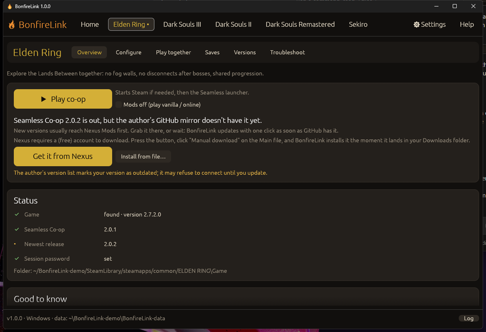
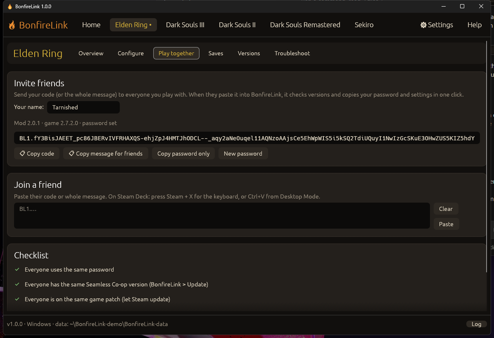
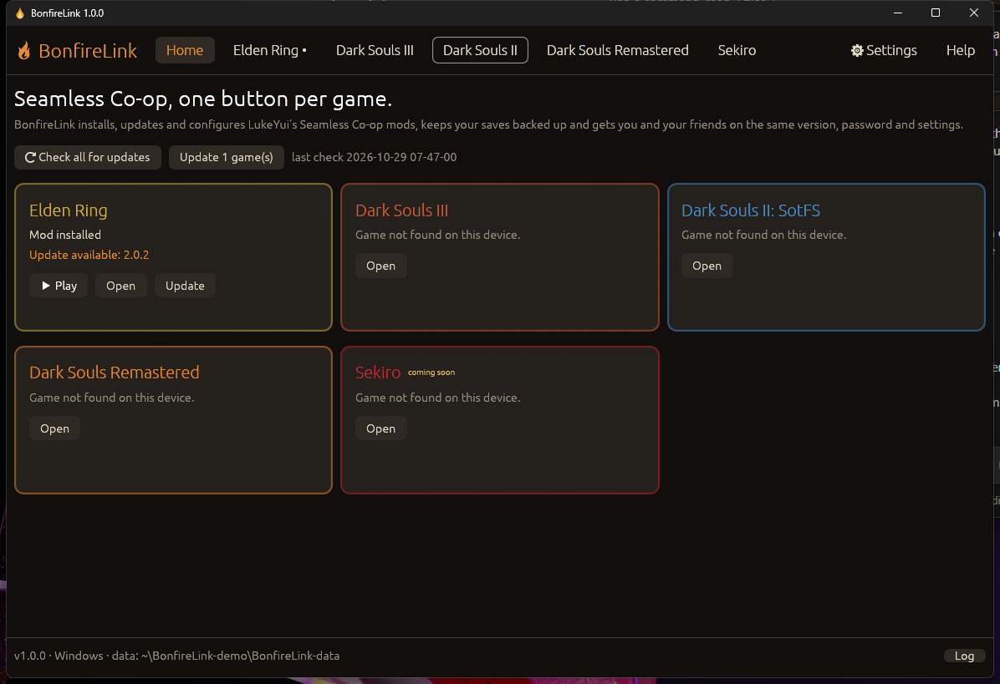
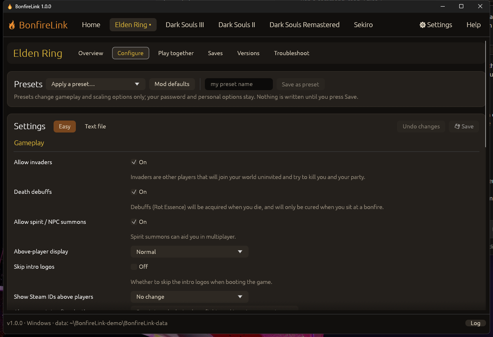
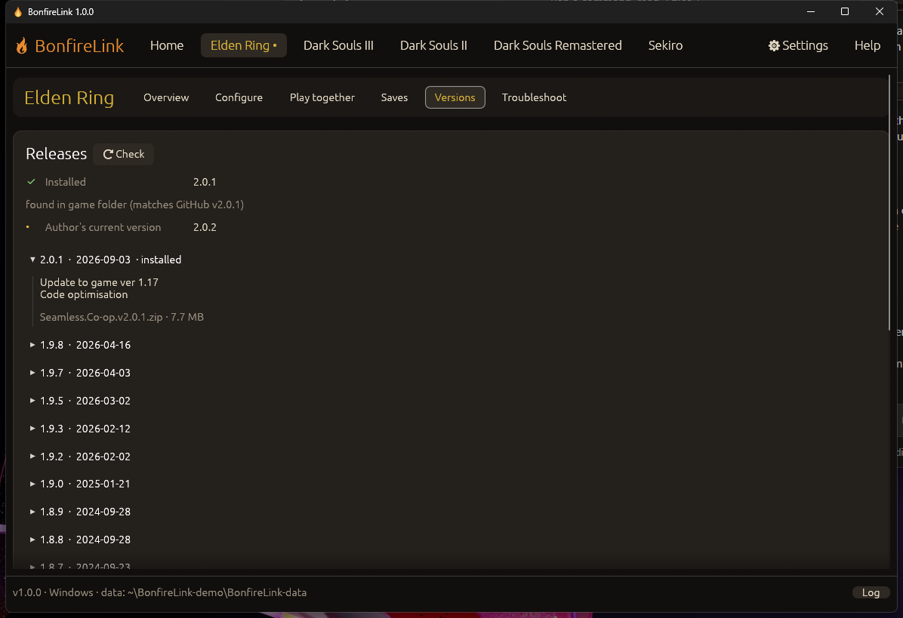
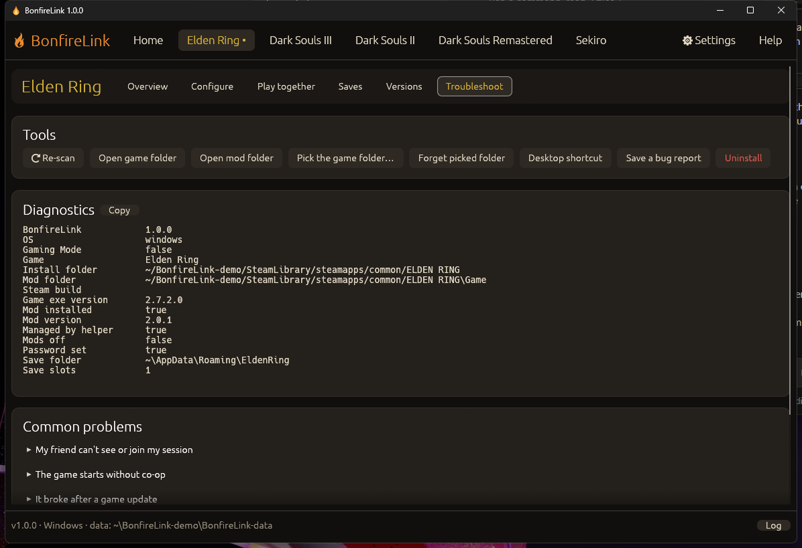

<div align="center">

# 🔥 BonfireLink

**One button per game for Seamless Co-op.**
Install, update, configure and share LukeYui's Seamless Co-op mods for
**Elden Ring · Dark Souls III · Dark Souls II: SotFS · Dark Souls Remastered · Sekiro**
on **Windows** and **Steam Deck**.

[](https://github.com/clawdroppin/BonfireLink/releases/latest/download/BonfireLink-windows-x64.exe)
[](https://github.com/clawdroppin/BonfireLink/releases/latest/download/BonfireLink-SteamDeck.tar.gz)

[All releases](https://github.com/clawdroppin/BonfireLink/releases) · [Website](https://clawdroppin.github.io/BonfireLink/) · [Report a problem](https://github.com/clawdroppin/BonfireLink/issues)



</div>

> **Unofficial fan tool.** Seamless Co-op is made by **LukeYui (Yui)**. BonfireLink only downloads the mod from the
> author's official GitHub releases or from Nexus Mods and never changes the mod's files.
> Please support the author on [Nexus Mods](https://www.nexusmods.com/eldenring/mods/510).

---

## What it does

| | |
|---|---|
| **🎮 One tab per game** | Elden Ring, Dark Souls III, Dark Souls II: SotFS, Dark Souls Remastered and Sekiro, each with Overview · Configure · Play together · Saves · Versions · Troubleshoot. |
| **⬇ Auto-updates** | Checks the author's release feeds on start. GitHub builds install with one click (checksum verified). Nexus-only builds: one click with a Nexus Premium key, or press *Get it from Nexus* and BonfireLink installs the file the moment it lands in your Downloads folder. |
| **🔑 Nexus account link** | *Settings > Nexus Mods* (or the game's Overview) opens your Nexus API-key page; paste the key and BonfireLink checks it. **Premium**: installs and updates from Nexus are fully automatic, including from the Steam Deck's Play button. **Free account**: tick *Handle Nexus "Mod Manager Download" buttons* and one click on Nexus installs the file, even when BonfireLink is closed (Nexus only allows app downloads for free accounts after that click). |
| **⚙ Settings editor** | Every option from the mod's `*_settings.ini` as toggles, sliders and dropdowns, read from the file itself, so options added in future releases show up without a BonfireLink update. Plus a raw text editor, per-option "back to default", and live 2P/3P/4P multipliers for scaling. |
| **🎚 Presets** | Relaxed story · Balanced · Veteran · Nightmare · No scaling · PvP night · Streamer, plus your own saved presets. Presets touch gameplay and scaling only; your password and personal options stay. |
| **🤝 Code matching** | *Play together* builds a `BL1.…` session code (game, mod version, game version, password, shared settings). Your friend pastes it, or the whole Discord message, and sees a green/red comparison with one-click *Use their password + settings* or *Update me to their version*. |
| **💾 Save safety** | Automatic backups before every install, manual backups, restore (your current saves are backed up first), extra backup folder (SD card / USB / cloud folder), and one-click **vanilla ⇄ co-op** save copy (`.sl2` ⇄ `.co2`). |
| **⏪ Rollback** | Every update keeps the version it replaced. Install any older GitHub release, or roll back in one click. Your settings carry over both ways. |
| **🕹 Steam Deck automation** | Sets each game's Steam launch option once. From then on Steam's normal **Play** button (also in Gaming Mode) updates the mod and starts Seamless Co-op under Proton. *Mods off* switches back to vanilla without touching Steam. |
| **🩺 Troubleshooting** | Diagnostics, conflict detection (Mod Engine 2, me3, stray `dinput8.dll`, old Deck exe-swap tricks), game-patch alerts, common fixes, and a one-click bug report zip with the password removed. |
| **📦 Portable** | One file, no installer, no runtime. Everything it keeps lives in `BonfireLink-data/` next to the app. Updates itself (SHA-256 checked). |

Already installed Seamless Co-op by hand? BonfireLink adopts it, works out which release it is by hashing the DLL
against the official archives, and keeps your settings and password on every update.

## Install

### Windows

1. Download **[BonfireLink-windows-x64.exe](https://github.com/clawdroppin/BonfireLink/releases/latest/download/BonfireLink-windows-x64.exe)** and put it in its own folder (for example `Documents\BonfireLink`).
2. Run it. Your Steam libraries are scanned automatically.
3. Pick a game tab and press **Install Seamless Co-op**, set a password (or press *Generate*), then **▶ Play co-op**.

Windows SmartScreen may warn about an unknown app the first time: *More info → Run anyway*.
Want a desktop icon? *Troubleshoot → Desktop shortcut* creates one that starts the game with Seamless Co-op.

### Steam Deck

**Easiest: one line in Konsole (Desktop Mode).** Downloads, verifies, installs to `~/Applications/BonfireLink`, adds a menu and desktop entry, and starts it:

```bash
curl -fsSL https://github.com/clawdroppin/BonfireLink/releases/latest/download/install-steamdeck.sh | bash
```

**Or by hand:** download **[BonfireLink-SteamDeck.tar.gz](https://github.com/clawdroppin/BonfireLink/releases/latest/download/BonfireLink-SteamDeck.tar.gz)**, extract it, and double-click `BonfireLink` (if nothing happens: right-click → Properties → Permissions → *Is executable*).

Then, once, in Desktop Mode:

1. Install Seamless Co-op for your games.
2. Home → **Set launch options** (Steam closes and reopens once).
3. Home → **Add BonfireLink to Steam** so you can open it from Gaming Mode.

That's it. In Gaming Mode just press **Play** on the game: BonfireLink's launch wrapper updates the mod when a new
build is available and starts Seamless Co-op. Settings, presets, backups and codes all work from Gaming Mode too.

<details>
<summary>How the Steam Deck automation works</summary>

BonfireLink writes a tiny POSIX script, `bonfirelink-launch.sh`, next to the game exe and adds it in front of
`%command%` in the game's Steam launch options (your own launch options are kept). When Steam starts the game, the
script:

1. runs `BonfireLink --auto-update <game>` (90-second cap; skipped when offline or switched off in Settings),
2. starts the game normally when *Mods off* is on or the launcher is missing,
3. otherwise swaps the game exe in Steam's command for the Seamless launcher, so Proton runs the launcher.

Uninstall removes the script and the launch option again. Steam has to be closed while launch options change, so
that one step needs Desktop Mode; Steam is never restarted from Gaming Mode.
</details>

## Playing together

1. Everyone installs BonfireLink and Seamless Co-op for the same game.
2. The host opens **Play together** and presses **Copy message for friends**, then sends it on Discord or Steam chat.
3. Friends paste the message into **Play together → Join a friend**. Every row turns green or tells them exactly what to fix.
4. In game, rest at the first bonfire / site of grace to get the mod's items: the host uses the host item, the others join with the join item.



## Games

| Game | Mod source | One-click install | Notes |
|---|---|---|---|
| Elden Ring | GitHub + Nexus | ✅ | Easy Anti-Cheat stays off when started through the launcher. Co-op saves are `ER0000.co2`. |
| Dark Souls III | Nexus | with Nexus Premium key, otherwise *Get it from Nexus* | |
| Dark Souls II: SotFS | GitHub + Nexus | ✅ | Scholar of the First Sin only. Young mod (0.0.x), updates often. |
| Dark Souls Remastered | Nexus | with Nexus Premium key, otherwise *Get it from Nexus* | |
| Sekiro | not released yet | — | BonfireLink watches the author's repo and offers the install the day it ships. |

## Screenshots

| Home | Configure |
|---|---|
|  |  |
| **Versions** | **Troubleshoot** |
|  |  |

## FAQ

<details><summary><b>My friend can't see or join my session.</b></summary>
Same mod version, same game patch, exactly the same password. Paste their code in <i>Play together</i> and fix every red row.</details>

<details><summary><b>The game started without co-op.</b></summary>
Windows: start with BonfireLink's Play button or the desktop shortcut (Steam's own Play button starts the normal game).
Steam Deck: check Overview → <i>Steam launch option</i> and make sure <i>Mods off</i> isn't ticked.</details>

<details><summary><b>It broke after a game update.</b></summary>
Game patches can break the mod until the author updates it. BonfireLink shows the new version as soon as it's out. Meanwhile tick <i>Mods off</i> and play vanilla.</details>

<details><summary><b>How do I connect my Nexus account?</b></summary>
Settings > Nexus Mods > <i>Open my Nexus API key page</i>, log in, copy the <i>Personal API Key</i>, then <i>Paste</i> and <i>Save &amp; check</i> in BonfireLink (on the Deck in Gaming Mode: Steam + X opens the keyboard). With Premium everything is automatic. With a free account, also tick <i>Handle Nexus "Mod Manager Download" buttons</i>: if Vortex or Mod Organizer 2 had those links, BonfireLink remembers them and hands them back when you untick it. The key is stored in plain text in <code>BonfireLink-data/settings.json</code>.</details>

<details><summary><b>My antivirus removed the launcher.</b></summary>
Seamless launchers inject a DLL into the game, which some antivirus programs flag. Restore it from quarantine (or allow the game folder) and reinstall from <i>Versions</i>.</details>

<details><summary><b>Can I use my normal character in co-op?</b></summary>
Yes: <i>Saves → Vanilla > co-op</i> copies it (the co-op save is backed up first). Going back the other way works too, but only take a co-op character into vanilla online play if it holds nothing the official game wouldn't allow.</details>

<details><summary><b>Where does BonfireLink keep things?</b></summary>

| What | Where |
|---|---|
| Settings, state, logs | `BonfireLink-data/` next to the app |
| Save backups | `BonfireLink-data/backups/<game>/` (+ your extra backup folder) |
| Previous mod versions | `BonfireLink-data/rollback/<game>/` |
| Settings-file history | `BonfireLink-data/ini-backup/` |
| Bug reports | `BonfireLink-data/reports/` |
| Mod files | the game's folder (`Game/` for ER, DS3, DS2; root for DSR, Sekiro) |
| Deck launch wrapper | `<game folder>/bonfirelink-launch.sh` and `<game folder>/.bonfirelink/` |
</details>

## Command line

```text
BonfireLink --status                 list games and installed mod versions
BonfireLink --update [er ds3 …]      install the newest mod (all games when none given)
BonfireLink --auto-update <game>     what the Steam Deck launch wrapper runs before a game starts
BonfireLink --print-wrapper <game>   print the Steam Deck launch wrapper script
BonfireLink --install-nxm <nxm://…>  install a Nexus "Mod Manager Download" link
```

## Building from source

Stable Rust (edition 2024). On Windows:

```powershell
rustup target add x86_64-unknown-linux-gnu   # one-time, for the Steam Deck build
cargo install cargo-zigbuild                  # one-time
python -m pip install --user ziglang          # one-time
.\build.ps1                                   # tests, Windows exe, Linux binary, packages into dist\
```

The Windows exe links the C runtime statically; the Linux binary targets glibc 2.28 and links only libc, libm,
libdl and libpthread (`scripts/check_elf.py` enforces this), so it runs on every SteamOS 3 release.

Contributors and AI coding agents: start with **[AGENTS.md](AGENTS.md)**.

## Credits & license

- **Seamless Co-op** by [LukeYui (Yui)](https://github.com/yuiamoroll): all credit for the mods goes to the author.
- BonfireLink is MIT licensed (see [LICENSE](LICENSE)). Elden Ring, Dark Souls and Sekiro are trademarks of their
  owners; this project isn't affiliated with FromSoftware, Bandai Namco or Activision.
